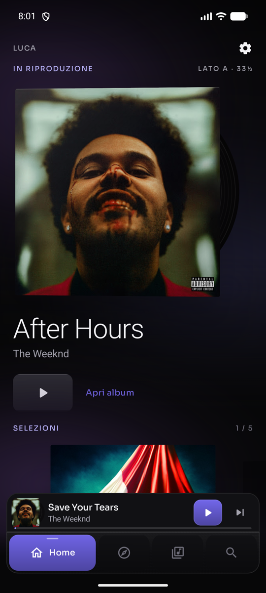
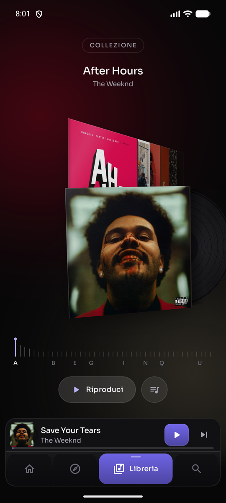
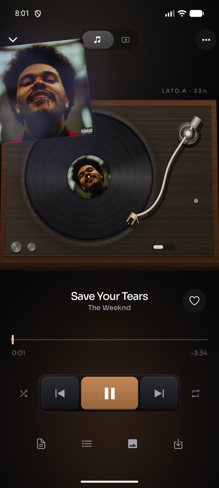

# Atelier skin

Atelier is a Levyra skin set in a dark listening room. Album sleeves stand on a shelf in real perspective, and the player is a walnut turntable that the record lands on. Everything is drawn in Kotlin and Jetpack Compose. The skin ships no bitmaps, fonts or third-party assets: the deck, platter, tonearm, vinyl and sleeve materials are painted at runtime.

| Home | Shelf | Turntable |
| --- | --- | --- |
|  |  |  |

## Colour

The interface is carbon black with a fine carbon-weave texture on the navigation and transport. It has a single accent taken from the cover that is playing: brightened, cross-faded over 600ms, and used for the play keys, the selected tab, the seek wave and section labels. Greyscale covers fall back to lavender. The Material colour scheme follows the same accent, so dialogs and switches match.

## Surfaces

| Surface | Owner |
| --- | --- |
| Theme, tokens, typography (Sora), shapes | `ui/theme/AtelierTheme.kt` |
| Shelf (3D sleeves, dial, ambient light) | `ui/atelier/AtelierShelfScreen.kt`, `AtelierShelfModel.kt`, `AtelierSleevePainter.kt` |
| Turntable player and transport | `ui/player/AtelierPlayer.kt`, `ui/atelier/AtelierDeckPainter.kt` |
| Navigation and mini player console | `ui/AtelierChrome.kt` |
| Home, Explore, Search, Library | `ui/AtelierHome.kt`, `ui/AtelierExplore.kt`, `ui/AtelierSearch.kt`, `ui/library/AtelierLibrary.kt` |
| Album, playlist and artist pages | `ui/media/AtelierMediaHero.kt`, `ui/AtelierArtist.kt` |
| Settings, queue, lyrics, actions, credits | `ui/AtelierSettings.kt`, `ui/player/AtelierQueue.kt`, `ui/AtelierLyrics.kt`, `ui/player/AtelierPlayerActions.kt` |
| Strings | `ui/i18n/LevyraAtelierStrings.kt` |

The skin is wired like the other skins: a `LevyraSkin.Atelier` entry, a palette id checked through `LevyraIsAtelier`, and one branch at each existing skin seam. Playback, MediaSession, queue, providers, lyrics, downloads and the audio pipeline are untouched; every animation reads player state and never drives it.

## Shelf

The Shelf opens inside Library. A "Collection" pill switches to the list view and back.

- **Scene.** One `Canvas` draws every visible sleeve. Each sleeve has a slot (position, yaw, pitch, roll, alpha) computed from its distance to the current selection, projected through a pinhole camera into a quad, and mapped onto the cover with `Matrix.setPolyToPoly`. Sleeves to the right recede at -50°, sleeves to the left fold away at +50°, and the selected one stands forward, slightly turned, with its record half out.
- **Input.** A horizontal drag moves a continuous position; release projects the fling velocity and settles on a sleeve with a low-stiffness spring. A tap on the front sleeve plays it and opens the player; taps on either stack step one sleeve. The A–Z dial below scrubs the whole shelf.
- **Light.** Two radial glows take their colour from the current and next covers (saturated tone and mean tone, sampled from a 24px decode) and cross-fade with the scroll position, so the room tints as you browse.
- **Materials.** A drop shadow from a baked soft mask, a spine shade, a fold gradient, an edge highlight and a sheen whose phase follows depth.
- **Content.** Real Levyra data only: albums grouped from favourites, recent plays and downloads, the user's playlists, and suggested albums. Up to 160 items, sorted by title. The selection survives recomposition and rotation through a saved key.

## Turntable player

The player has one scene clock, the existing player expansion value. Opening runs it from 0 to 1 in 1250ms; closing runs it back in 1050ms, so the close is exactly the open reversed and an interrupted gesture continues from where it is.

| Clock | What moves |
| --- | --- |
| 0.00–0.46 | The sleeve leaves its origin (the shelf quad, or the mini player artwork) and settles top-left with a -6° roll |
| 0.08–0.46 | The room darkens behind it, warm key light from the top, cover-tinted light from below |
| 0.18–0.64 | The deck rises from below, its perspective flattening to top-down |
| 0.28–0.48 | The record slides out of the sleeve |
| 0.46–0.90 | The record arcs onto the platter, lifting and growing, its shadow converging |
| 0.80–1.00 | Metadata, seek bar and transport fade up |
| 0.90–1.00 | The tonearm swings onto the groove |

During playback:
- the platter spins at 200°/s and spins up in 620ms after play, coasting down over 1.5s after pause;
- the tonearm tracks the groove radius from the song position (outer to inner groove) on a soft spring, and returns to its rest when paused;
- a track change cross-fades the sleeve and the record label in 280ms without rebuilding the scene.

The transport is a deck console: a recessed carbon tray with mechanical keys that press down; the play key is filled with the accent taken from the playing cover and its glyph morphs between play and pause. The seek bar is a wave in the cover accent that flows while the song plays and rests when paused. Canvas motion artwork keeps working and is shown inside the sleeve.

## Performance

- The deck, tonearm, vinyl disc and light are baked once per size on `Dispatchers.Default`, converted to hardware bitmaps where possible, and reused every frame. Nothing is decoded or allocated per frame.
- Shelf covers load through the existing Coil loader at the drawn size, only for a window of ±5 sleeves around the selection; covers leaving the window are released.
- Rotation pauses when the app is stopped or the player is collapsed; audio is unaffected.
- Devices with low RAM or a small memory class use the standard quality tier: smaller bakes and no sheen or sleeve thickness.
- With animations disabled, the shelf snaps, the record does not spin and the clock jumps.

## Tests

`app/src/test/java/com/luc4n3x/levyra/ui/atelier/AtelierShelfModelTest.kt` covers shelf grouping and ordering, slot continuity across the front position, hit testing, groove tracking, clock ordering and ambient tone contrast.

## Validation status

See the pull request for the commands run, emulator evidence and anything left unverified.
